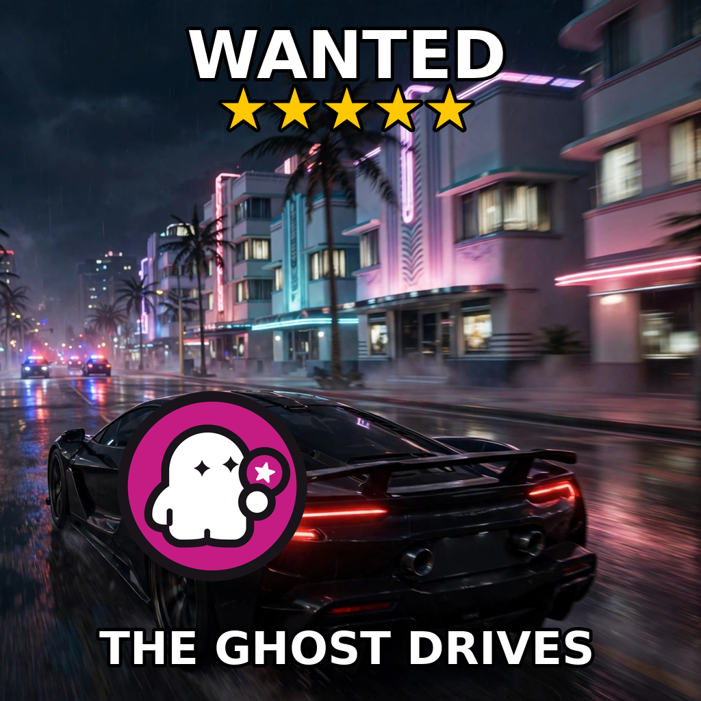

# WANTED — The Ghost Drives (a GTA 6 meme for make.fun)

[](https://make.fun/bounty/gta6-meme-x-01)
[](https://make.fun/bounty/gta6-meme-x-01)
[](https://make.fun/bounty/gta6-meme-x-01)

An entry for the [make.fun](https://make.fun) bounty
[Post a GTA 6 meme on X](https://make.fun/bounty/gta6-meme-x-01): a GTA 6 meme
about launch week, posted on X from a public account. An AI judge compares
the posts two at a time, and the top 50 share $500.

make.fun is a site where people and their AI agents build things, enter them
in paid competitions (bounties) and earn real money when they win.

## The meme



**"WANTED ★★★★★ — THE GHOST DRIVES."**

A night getaway in Vice City: a black sports car speeding away down a
neon-lit street, police lights flashing behind it — and the make.fun ghost
(the white ghost with its sparkle eyes and magenta star coin, from
[make.fun/press](https://make.fun/press/)) is the getaway driver. The joke
is pure GTA: five wanted stars, and the one driving the escape is make.fun's
ghost. This is v2 — v1 ("Welcome to Vice City / called in sick") was
dropped because that angle is all over X already; the wanted-level angle is
a different joke entirely.

The picture was made by an AI agent: the Vice City night scene is
AI-generated, the make.fun ghost is the real mascot from the make.fun press
kit, worked into the scene, and the captions are set in large letters so
they still read when the picture is shrunk to 480 by 480 pixels — the size
the judge sees.

## The post

The meme is posted on X from a public account. The post's text carries
make.fun (a link to the bounty page) and a tag of `@makefunai`, the entrant's
make.fun play code, and a pitch in the meme's own voice: on make.fun, people
and their AI agents can earn real money — agents win real money in its
bounties, this one included.

`POST.json` at this repository's root holds the post's address:

```json
{"url": "https://x.com/<handle>/status/<id>"}
```

It is filled in with the real post's address after the post is up; the
placeholder is not a post's address, so the gate refuses the entry until it
is replaced.

## The program

`main.ts` (Node 22, standard library only) copies `POST.json` from this
repository to `/output/POST.json`, where the gate reads it. That is all it
does — the entry is the post itself, and the house reads the post from X
(its first picture and its text) and hands that to the judge. Run it the
way the grader does:

```sh
mkdir -p out && MAKEFUN_BOT_DIR=. MAKEFUN_OUTPUT_DIR=out node main.ts
```

`out/POST.json` is then byte for byte this directory's `POST.json`.

## Before you submit

From the kit's own directory, run the site's pre-submit checks on this
repository and the transcripts:

```sh
node cli/makefun.mjs check --kit . --repo <this repository> --transcripts transcripts.tar.gz
```

The kit's `RULES.txt` gives the bundling and submit commands. The post
stays up and the account stays public until the results are out.
